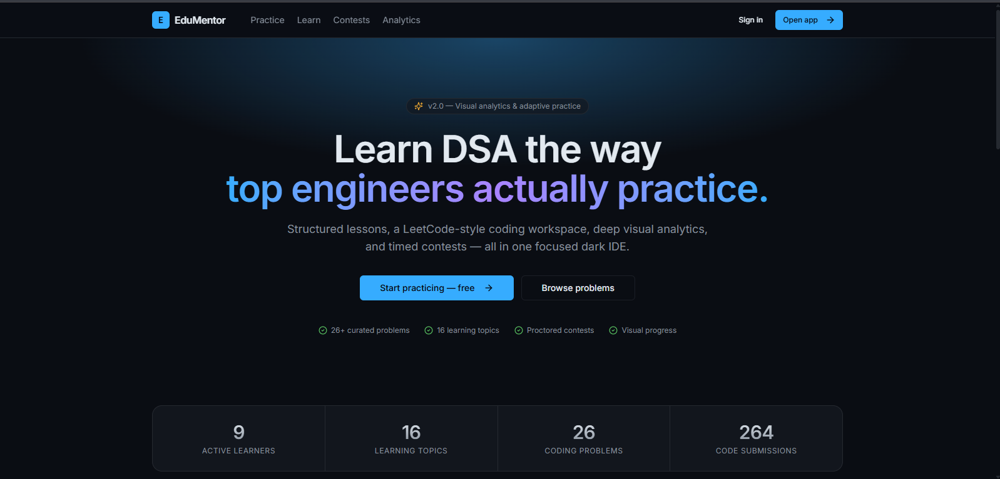

# EduMentor — AI-Powered DSA Learning Platform

EduMentor combines DSA lessons, a coding workspace, proctored tests and an AI mentor in one place.
Learners study a topic, take an AI-generated quiz, solve problems in the browser, and get told what to study next.

**Stack:** React · Vite · TanStack Query · Tailwind CSS · Flask · SQLAlchemy · Socket.IO · Google Gemini · scikit-learn · Judge0 · TensorFlow.js

## Features

### For learners
| Feature | What it does |
|---|---|
| **Coding workspace** | CodeMirror editor for Python, C++ and Java; code runs on Judge0 against hidden test cases |
| **AI code analysis** | Compares your time complexity with the optimal solution and suggests improvements |
| **AI mentor** | Gives hints in levels before full solutions; also reviews code, helps debug and builds study plans |
| **AI quizzes** | 5 fresh Gemini-generated questions per topic; score 3/5 to pass and earn XP |
| **Proctored tests** | Fullscreen, tab-switch and copy/paste detection, webcam face detection (TensorFlow.js) and microphone checks |
| **Topic mastery** | A scikit-learn model classifies each topic as Strong, Average or Weak after every test |
| **Analytics** | XP breakdown, quiz pass rate, 30-day submission history and per-topic study time |
| **Community** | Real-time topic channels and mentor chat (Socket.IO), plus flash notes and notifications |

### For instructors
- **Dashboard** with platform activity, top learners and recent submissions
- **Learner profiles** with 30-day activity, topic progress, practice and test history
- **Content management** for topics, problems (visual test-case editor) and tests, with CSV import
- **Announcements** with read tracking, a mentor inbox and community moderation

## Tech Stack

| Layer | Technologies |
|---|---|
| Frontend | React, Vite, React Router, TanStack Query, Tailwind CSS, Recharts, CodeMirror |
| Backend | Flask (REST API), SQLAlchemy, Flask-Login, Flask-SocketIO, SQLite |
| AI / ML | Google Gemini API, scikit-learn, TensorFlow.js |
| Services | Judge0 (code execution), YouTube Data API |
